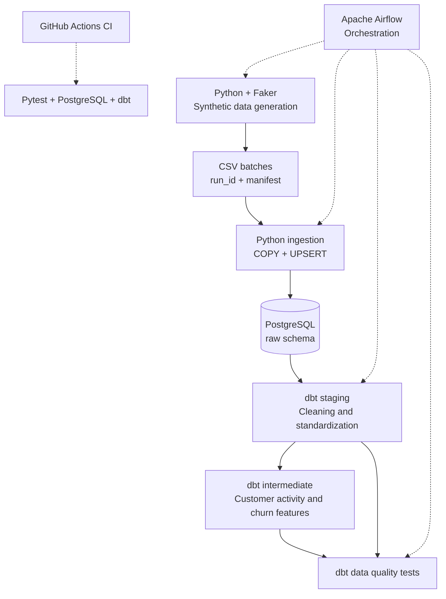

# E-Commerce Analytics Pipeline

[](https://github.com/ayrtonbezerra/E-commerce-ETL/actions/workflows/ci.yml)

An end-to-end batch data pipeline built with **Python, PostgreSQL, dbt, and Apache Airflow**, featuring incremental ingestion, idempotent processing, automated data quality checks, and continuous integration.

This project demonstrates practical analytics engineering concepts through a simulated e-commerce environment. It covers the full lifecycle from source data generation and ingestion to SQL transformations, data validation, and workflow orchestration.

## Key Features

- **Incremental ingestion:** New orders and order items are appended without replacing previously ingested records.
- **Idempotent processing:** Reprocessing the same batch does not create duplicate records or unnecessary updates.
- **Reproducible data generation:** Deterministic synthetic datasets are generated using Faker and identified by Airflow's `run_id`.
- **SQL transformations with dbt:** Raw data is standardized and transformed into analytics-ready models.
- **Automated data quality:** Generic and custom dbt tests enforce data integrity and business rules.
- **Python testing:** Pytest validates data generation, identifier uniqueness, referential consistency, and input validation.
- **Continuous integration:** GitHub Actions executes automated tests against a temporary PostgreSQL database.

## Architecture



Airflow orchestrates the local pipeline using the Astro CLI. The DAG is configured for weekly execution, with retries and controlled task dependencies.

GitHub Actions independently validates the code and SQL models in a clean environment.

## Tech Stack

| Technology | Purpose |
|---|---|
| Python | Synthetic data generation and ingestion |
| Faker | Realistic synthetic customers, products, and transactions |
| PostgreSQL 17 | Relational storage for raw and transformed data |
| psycopg | PostgreSQL connectivity and bulk loading |
| dbt Core | SQL transformations, model dependencies, and data quality |
| Apache Airflow | Workflow orchestration and task scheduling |
| Astro CLI / Docker | Local containerized Airflow environment |
| Pytest | Automated Python tests |
| GitHub Actions | Continuous integration |
| uv | Python dependency management |

## Pipeline Design

### 1. Synthetic Data Generation

The pipeline generates five datasets:

| Dataset | Description |
|---|---|
| `customers` | Customer information and registration dates |
| `products` | Product catalog, categories, prices, and costs |
| `orders` | Orders, associated customers, dates, and statuses |
| `order_items` | Products and quantities associated with each order |
| `cancelamentos` | Order cancellation reasons and dates |

Each Airflow execution is associated with a unique `run_id`.

The generator uses deterministic random seeds and derives batch-specific identifiers from the `run_id`. Generated CSV files and a manifest are stored in a dedicated directory for each batch.

When an existing batch is requested again, the generator reuses its previously generated files.

### 2. Incremental and Idempotent Ingestion

The ingestion process uses PostgreSQL's `COPY` command and `INSERT ... ON CONFLICT` to load records efficiently.

The workflow for each table is:

1. Validate the batch manifest and CSV header.
2. Load the CSV into a temporary PostgreSQL table using `COPY`.
3. Insert new records into the `raw` schema.
4. Update existing records only when their values have changed.
5. Commit the transaction.

The core approach follows this SQL pattern:

```sql
INSERT INTO raw.orders (...)
SELECT ...
FROM staging_table
ON CONFLICT (order_id)
DO UPDATE SET ...
WHERE (...) IS DISTINCT FROM (...);
```

This design addresses two different requirements:

**Incrementality:** New transactional records accumulate across successive pipeline executions.

**Idempotency:** Reprocessing an identical batch leaves the target table unchanged.

Customer and product datasets currently behave as stable snapshots, while orders and order items are generated as new transactional batches.

The ingestion strategy was validated by reprocessing an existing batch and confirming that no records were inserted or updated. A subsequent execution added exactly the configured number of new orders without removing historical records.

### 3. Data Transformation with dbt

The project separates ingestion from transformation.

**Raw layer — `raw` schema**

Stores the datasets ingested by Python. dbt references these tables through source definitions.

**Staging layer — `analytics` schema**

The staging models standardize raw data through type casting, string normalization, and field selection:

- `stg_customers`
- `stg_products`
- `stg_orders`
- `stg_order_items`
- `stg_cancelamentos`

These models are materialized as views.

**Intermediate layer**

The `int_churn_prediction_data` model aggregates customer order activity, including:

- Total number of orders
- First and most recent order dates
- Cancellation count
- Activity period
- A rule-based churn indicator

The churn indicator identifies customers whose most recent order was more than 90 days ago. It is a heuristic business rule, not a trained machine learning model.

The current dbt transformations use regular model materializations; incremental processing is implemented in the ingestion layer.

## Data Quality and Testing

The project uses two complementary testing strategies.

### dbt Tests

Generic tests validate fundamental data integrity:

- `unique` for primary identifiers
- `not_null` for required fields
- `relationships` for referential integrity
- `accepted_values` for valid order statuses

Custom SQL tests validate business rules, including:

- Order item quantities must be positive.
- Product prices must be positive and costs nonnegative.
- Cancellation records must reference canceled orders.
- Cancellation dates cannot precede order dates.

A dbt test fails when its validation query returns records that violate the corresponding rule.

### Pytest

Four automated Python tests cover:

| Test | Purpose |
|---|---|
| Batch reproducibility | Verify that the same `run_id` produces identical data |
| Identifier uniqueness | Verify that different batches do not share order or order-item IDs |
| Generated data integrity | Validate relationships between generated entities |
| Input validation | Reject CSV files with invalid headers before database access |

Tests use temporary directories and mocks to avoid modifying production-like data during unit testing.

An integration test against PostgreSQL for the UPSERT behavior remains a possible future improvement.

## Continuous Integration

The GitHub Actions workflow runs automatically on pushes and pull requests targeting `main`.

The CI pipeline performs the following steps:

1. Set up Python 3.11 and install dependencies using uv.
2. Execute the Pytest suite.
3. Start a temporary PostgreSQL 17 service.
4. Generate synthetic e-commerce data.
5. Ingest all five datasets into PostgreSQL.
6. Execute `dbt run`.
7. Execute `dbt test`, including generic and custom SQL tests.

A failure in any step causes the CI job to fail.

[View the CI workflow and execution history](https://github.com/ayrtonbezerra/E-commerce-ETL/actions/workflows/ci.yml)

This project implements continuous integration, not automated production deployment.

## Getting Started

### Prerequisites

- Docker Desktop with Linux containers
- Astronomer Astro CLI
- Git
- Python 3.11 and uv (for local Python development and tests)

### 1. Clone the repository

```bash
git clone https://github.com/ayrtonbezerra/E-commerce-ETL.git
cd E-commerce-ETL
```

### 2. Configure environment variables

Create a `.env` file in the repository root:

```dotenv
POSTGRES_PASSWORD=your_local_password

DBT_HOST=ecommerce-db
DBT_PORT=5432
DBT_USER=ecommerce_user
DBT_ENV_SECRET_PASSWORD=your_local_password
DBT_DATABASE=ecommerce
DBT_SCHEMA=analytics

SCRIPT_PATH=/usr/local/airflow/include/scripts
DBT_PROJECT_DIR=/usr/local/airflow/include/dbt_ecommerce
DBT_PROFILES_DIR=/usr/local/airflow/include/dbt_ecommerce
OUTPUT_PATH=/usr/local/airflow/include/data

N_CUSTOMERS=100
N_PRODUCTS=50
N_ORDERS=200
```

Use the same password for `POSTGRES_PASSWORD` and `DBT_ENV_SECRET_PASSWORD`.

The `.env` file is excluded from Git to prevent accidental credential exposure.

### 3. Configure the dbt profile

Create `include/dbt_ecommerce/profiles.yml`:

```yaml
dbt_ecommerce:
  target: dev
  outputs:
    dev:
      type: postgres
      host: "{{ env_var('DBT_HOST') }}"
      port: 5432
      user: "{{ env_var('DBT_USER') }}"
      password: "{{ env_var('DBT_ENV_SECRET_PASSWORD') }}"
      dbname: "{{ env_var('DBT_DATABASE') }}"
      schema: "{{ env_var('DBT_SCHEMA') }}"
      threads: 2
```

The profile is excluded from version control. GitHub Actions generates its own temporary dbt profile.

### 4. Start the environment

```bash
astro dev start
```

The Airflow interface is available at:

`http://localhost:8080`

The e-commerce PostgreSQL instance is also accessible from the host at `localhost:5433`.

### 5. Run the core pipeline manually

Open a shell inside the Astro environment:

```bash
astro dev bash
```

Generate a sample batch:

```bash
python /usr/local/airflow/include/scripts/generate_fake_data.py \
  --run-id "demo-batch-001" \
  --run-date "2026-11-01"
```

Ingest the generated datasets:

```bash
for table in customers products orders order_items cancelamentos; do
  python /usr/local/airflow/include/scripts/load_data.py \
    "$table" --run-id "demo-batch-001"
done
```

Run the dbt transformations and tests:

```bash
/usr/local/airflow/dbt_venv/bin/dbt run \
  --project-dir /usr/local/airflow/include/dbt_ecommerce \
  --profiles-dir /usr/local/airflow/include/dbt_ecommerce

/usr/local/airflow/dbt_venv/bin/dbt test \
  --project-dir /usr/local/airflow/include/dbt_ecommerce \
  --profiles-dir /usr/local/airflow/include/dbt_ecommerce
```

The Airflow DAG is named `ecommerce_analytics_dag`. It also includes a Telegram reporting task that requires additional configuration, as described under Known Limitations.

### 6. Run Python tests

From the repository root, with uv installed:

```bash
uv sync --locked
uv run pytest tests/units -v
```

### 7. Inspect the results

Connect to the PostgreSQL database using a client such as DBeaver.

Example query:

```sql
SELECT
    status,
    COUNT(*) AS total_orders
FROM analytics.stg_orders
GROUP BY status
ORDER BY total_orders DESC;
```

You can also explore the models under the `analytics` schema.

## Project Structure

```text
.
├── .github/
│   └── workflows/
│       └── ci.yml
├── dags/
│   └── ecommerce_dag.py
├── include/
│   ├── scripts/
│   │   ├── generate_fake_data.py
│   │   ├── load_data.py
│   │   ├── prepare_incremental.py
│   │   └── generate_report.py
│   └── dbt_ecommerce/
│       ├── models/
│       │   ├── staging/
│       │   └── intermediate/
│       ├── tests/
│       └── dbt_project.yml
├── tests/
│   ├── dags/
│   └── units/
│       └── test_pipeline.py
├── Dockerfile
├── docker-compose.override.yml
├── pyproject.toml
├── uv.lock
└── README.md
```

Generated CSV batches, virtual environments, local credentials, and dbt build artifacts are excluded from version control.

## Design Trade-offs and Known Limitations

- **Synthetic data:** Faker replaces external transactional systems, allowing the pipeline to run without commercial APIs or datasets.
- **Batch processing:** The project focuses on scheduled batch ingestion rather than streaming.
- **Probabilistic ID allocation:** Batch-specific IDs are derived from hashes. Primary key constraints provide the final protection against collisions.
- **dbt materializations:** The dbt models are not currently incrementally materialized. Incrementality is implemented at the raw ingestion layer.
- **Telegram reporting:** The DAG includes a reporting step, but the published script still expects legacy CSV paths. It must be updated to read the batch layout or query PostgreSQL for a fully reproducible fresh installation.
- **Local infrastructure:** The main Airflow environment runs locally through Astro CLI and Docker rather than in a hosted production environment.

## Author

**Ayrton Bezerra**

Analytics Engineering and Data Analytics

[GitHub Profile](https://github.com/ayrtonbezerra)
