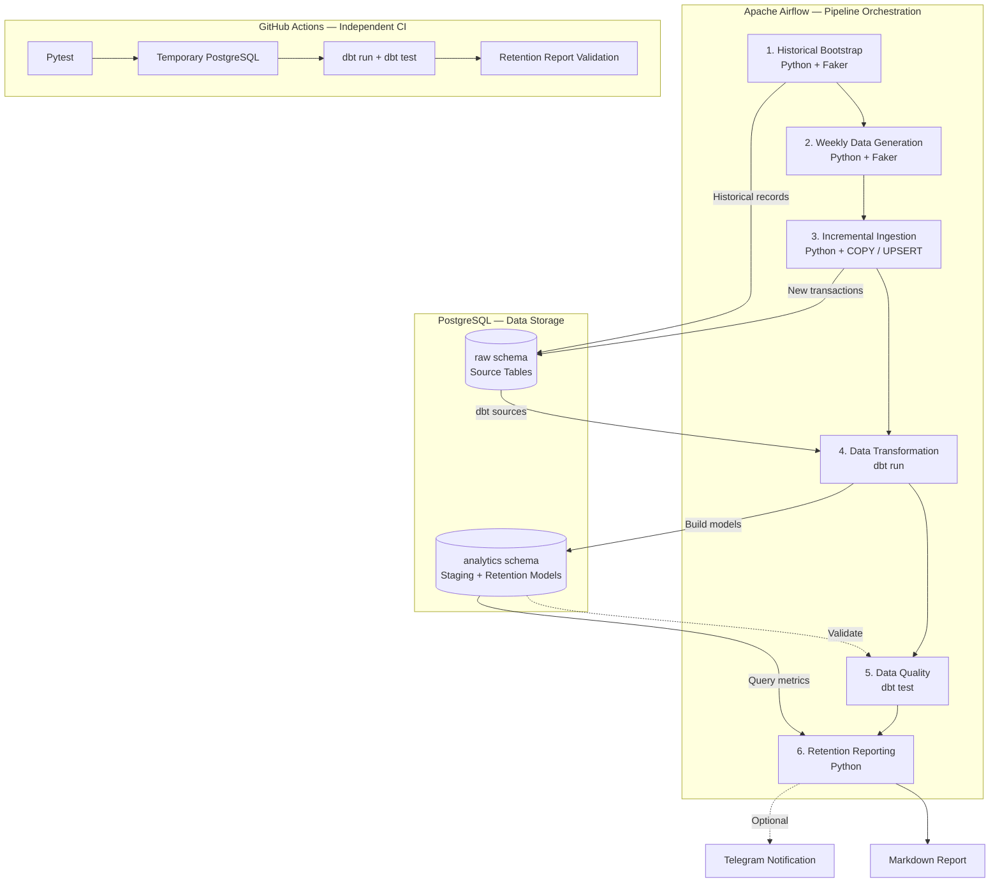

# E-commerce Customer Retention Analytics Pipeline

[](https://github.com/ayrtonbezerra/ecommerce-customer-retention-pipeline/actions/workflows/ci.yml)

**An end-to-end analytics engineering project that automates weekly customer retention monitoring using Python, PostgreSQL, dbt, and Apache Airflow.**

## Overview

Customer retention is a critical challenge for e-commerce businesses. Without consistent monitoring, companies may fail to identify customers who have stopped purchasing or those who are approaching inactivity thresholds.

This project simulates an e-commerce environment and builds an automated data pipeline that transforms transactional data into actionable customer retention insights.

Every week, the pipeline can generate a report answering questions such as:

- How many customers are active, at risk, or churned?
- How has customer inactivity changed over the past eight weeks?
- Which customers should be prioritized for reactivation?
- How does current order activity compare with the previous week?

The solution covers the full analytics lifecycle, from data ingestion and transformation to quality testing, orchestration, and automated reporting.

**All customer and transaction data is synthetic.** Churn is defined using an inactivity-based business rule rather than a predictive machine learning model.

## Key Features

- **Automated weekly reporting:** Airflow orchestrates data generation, ingestion, transformation, validation, and reporting.
- **Incremental ingestion:** New orders accumulate in PostgreSQL without replacing previously loaded transactions.
- **Idempotent processing:** Reprocessing an existing batch does not duplicate records.
- **Historical data simulation:** Faker generates a historical customer population with different purchasing behaviors.
- **Customer retention analytics:** dbt models classify customers and reconstruct eight weeks of retention metrics.
- **Automated data quality:** dbt and Pytest validate data integrity, business rules, and Python logic.
- **Continuous integration:** GitHub Actions runs automated tests against a temporary PostgreSQL instance.
- **Flexible reporting:** Reports are saved locally as Markdown and can optionally be sent through Telegram.

## Architecture


## Architecture



**Apache Airflow** orchestrates the complete workflow using the Astro CLI and Docker. **GitHub Actions** independently validates the pipeline in a clean environment.

## Quick Start

You can run the entire pipeline through the Airflow web interface. No external data sources, cloud accounts, or Telegram credentials are required.

### Prerequisites

- [Docker Desktop](https://www.docker.com/products/docker-desktop/) with Linux containers enabled
- [Astronomer Astro CLI](https://www.astronomer.io/docs/astro/cli/get-started-cli/)
- Git

### 1. Clone the repository

```bash
git clone https://github.com/ayrtonbezerra/ecommerce-customer-retention-pipeline.git
cd ecommerce-customer-retention-pipeline
```

### 2. Configure the environment

Create a `.env` file in the project root with the following configuration:

```dotenv
# PostgreSQL
POSTGRES_PASSWORD=your_local_password

DBT_HOST=ecommerce-db
DBT_PORT=5432
DBT_USER=ecommerce_user
DBT_ENV_SECRET_PASSWORD=your_local_password
DBT_DATABASE=ecommerce
DBT_SCHEMA=analytics

# Container paths
SCRIPT_PATH=/usr/local/airflow/include/scripts
DBT_PROJECT_DIR=/usr/local/airflow/include/dbt_ecommerce
DBT_PROFILES_DIR=/usr/local/airflow/include/dbt_ecommerce
OUTPUT_PATH=/usr/local/airflow/include/data

# Synthetic data volume
N_CUSTOMERS=100
N_PRODUCTS=50
N_ORDERS=200
```

Replace `your_local_password` with your chosen password, keeping both password values identical.

Next, create `include/dbt_ecommerce/profiles.yml`:

```yaml
dbt_ecommerce:
  target: dev
  outputs:
    dev:
      type: postgres
      host: "{{ env_var('DBT_HOST') }}"
      port: 5432
      user: "{{ env_var('DBT_USER') }}"
      password: "{{ env_var('DBT_ENV_SECRET_PASSWORD') }}"
      dbname: "{{ env_var('DBT_DATABASE') }}"
      schema: "{{ env_var('DBT_SCHEMA') }}"
      threads: 2
```

Both files are excluded from Git to avoid exposing local credentials.

### 3. Start the environment

From the project root, run:

```bash
astro dev start
```

Astro CLI builds and starts the local Airflow environment and PostgreSQL service.

Open the Airflow interface:

**http://localhost:8080**

### 4. Run the pipeline

In the Airflow interface:

1. Navigate to **Dags**.
2. Find `ecommerce_analytics_dag`.
3. Enable the DAG if it is paused.
4. Click **Trigger DAG** to start a manual execution.
5. Monitor each task in the Grid or Graph view.

The workflow executes the following tasks:

```text
bootstrap_history
       |
generate_fake_data
       |
load_customers
       |
load_products
       |
load_orders
       |
load_order_items
       |
load_cancelamentos
       |
    dbt_run
       |
    dbt_test
       |
 generate_report
```

The historical bootstrap is idempotent, so subsequent executions reuse the existing historical dataset instead of duplicating it.

New executions generate additional transactional batches.

### 5. View the report

After the DAG finishes successfully, open:

```text
include/reports/latest_report.md
```

If you are using VS Code, press `Ctrl + Shift + V` to preview the formatted Markdown report.

Each execution also saves a separate report under:

```text
include/reports/batches/
```

The reports include customer retention metrics, weekly activity, historical retention trends, and a prioritized list of customers for potential reactivation.

**Telegram is optional.** The local Markdown report is generated even when Telegram is not configured.

### Optional: Enable Telegram notifications

To receive the report automatically, create your own Telegram bot through [@BotFather](https://t.me/BotFather) and obtain the destination chat ID.

Add the following variables to your `.env`:

```dotenv
TELEGRAM_TOKEN=your_telegram_bot_token
TELEGRAM_CHAT_ID=your_chat_id
```

After restarting the Astro environment, subsequent successful DAG executions will also send the retention summary to your configured Telegram chat.

Without these variables, the DAG simply generates the local report.

## Customer Retention Analytics

The analytical models classify customers according to the time elapsed since their most recent completed order.

| Customer Segment | Definition |
|---|---|
| Active | Purchased within the last 60 days |
| At Risk | Last completed purchase was 61–90 days ago |
| Churned | More than 90 days since the last completed purchase |
| Never Purchased | Registered but has no completed orders |

Canceled orders do not count as completed purchases when calculating customer inactivity.

### Weekly Retention Report

The report contains four main sections.

**Customer Retention Snapshot**

Provides the current number of registered customers, customers with purchase history, churned customers, and customers at risk.

The churned buyer share is calculated as:

```text
Churned Buyer Share =
    Churned Customers / Customers with Completed Purchases
```

**Weekly Order Activity**

Summarizes orders, purchasing customers, cancellations, and changes in order volume compared with the preceding seven days.

**Eight-Week Retention Trend**

Shows the evolution of active, at-risk, and churned customer populations across eight weekly reference dates.

These historical classifications are reconstructed from transaction dates rather than stored as independent weekly snapshots.

**Reactivation Opportunities**

Identifies customers approaching the 90-day inactivity threshold and prioritizes them based on historical purchase frequency.

This provides a starting point for potential customer reactivation campaigns.

> **Important:** The churn metric is a rule-based inactivity indicator. It does not represent a trained churn prediction model, and the synthetic results should not be interpreted as real business performance.

## Data Pipeline Design

### Synthetic Data Generation

Python and Faker simulate five e-commerce datasets:

| Dataset | Description |
|---|---|
| `customers` | Customer information and registration dates |
| `products` | Product catalog, prices, costs, and categories |
| `orders` | Order dates, customers, and statuses |
| `order_items` | Products and quantities associated with orders |
| `cancelamentos` | Cancellation dates and reasons |

The generator supports two execution modes:

- **Historical bootstrap:** Creates an initial population with purchasing histories spanning several months, including active, at-risk, and churned customers.
- **Incremental batches:** Simulates newly arriving transactions for subsequent pipeline executions.

Each batch is associated with a reproducible identifier derived from the Airflow `run_id`. Generated CSVs are stored with a manifest, allowing an existing batch to be replayed without regenerating different data.

### Incremental and Idempotent Ingestion

The ingestion layer is implemented in Python using `psycopg` and PostgreSQL.

Instead of relying on `dbt seed` for operational ingestion, the pipeline loads source data directly into the `raw` schema.

The ingestion strategy follows three steps:

1. Validate the source CSV and load it into a temporary table using PostgreSQL `COPY`.
2. Merge records into the target table using `INSERT ... ON CONFLICT`.
3. Insert new records and update existing records only when their values have changed.

For example, an existing order can be updated without creating a duplicate, while newly generated orders are added to the accumulated dataset.

**Idempotency** ensures that processing the same batch repeatedly produces the same final state.

**Incrementality** allows new transactional batches to be added without rebuilding the entire raw dataset.

These behaviors were validated through repeated batch ingestion and additional DAG executions.

### SQL Transformations with dbt

dbt separates raw ingestion from analytics modeling.

| Layer | Purpose |
|---|---|
| `raw` | Source tables loaded by Python |
| `staging` | Standardization, field selection, and type casting |
| `intermediate` | Customer activity, churn classification, and weekly retention metrics |

The staging models are:

- `stg_customers`
- `stg_products`
- `stg_orders`
- `stg_order_items`
- `stg_cancelamentos`

The main analytical models include:

**`int_churn_prediction_data`**

Aggregates completed purchases and cancellations by customer, calculates purchase activity dates, and derives a rule-based churn indicator.

Despite its name, this model does not train or execute a predictive machine learning algorithm.

**`int_weekly_retention`**

Reconstructs eight weekly snapshots of customer activity and classifies customers into active, at-risk, churned, and never-purchased segments.

The dbt models are materialized as views. Incremental processing is implemented in the ingestion layer rather than through dbt incremental materializations.

## Data Quality and Automated Testing

The pipeline uses two complementary testing approaches.

### dbt Tests

Generic dbt tests validate:

- Unique identifiers and required fields
- Referential integrity between customers, orders, products, and order items
- Accepted order statuses

Custom SQL tests enforce business rules, including:

- Positive order item quantities
- Valid product prices and costs
- Consistent order cancellation statuses
- Valid cancellation dates
- Consistency between weekly retention segments and their corresponding customer populations

Airflow executes `dbt test` before generating the retention report. If a data quality test fails, the downstream reporting task is not executed.

### Pytest

The Python test suite validates:

- Reproducibility of generated batches
- Identifier uniqueness across different batches
- Referential integrity of synthetic transactions
- Rejection of CSVs with invalid headers
- Generation of historical customer retention segments

The tests use temporary directories and mocks to avoid modifying the local PostgreSQL database.

To run the Python tests manually, install [uv](https://docs.astral.sh/uv/) and execute:

```bash
uv sync --locked
uv run pytest tests/units -v
```

## Continuous Integration

GitHub Actions automatically validates changes pushed to `main` and pull requests targeting that branch.

The CI workflow:

1. Sets up Python and installs project dependencies.
2. Executes Pytest.
3. Starts a temporary PostgreSQL 17 instance.
4. Generates and ingests historical and incremental synthetic data.
5. Builds the dbt models.
6. Executes dbt data quality tests.
7. Generates the retention report without requiring Telegram credentials.

This ensures that the pipeline can be tested in an independent environment rather than relying exclusively on a developer's local setup.

[View GitHub Actions workflow](https://github.com/ayrtonbezerra/ecommerce-customer-retention-pipeline/actions/workflows/ci.yml)

## Optional: Validate Incrementality and Idempotency

The following checks allow you to inspect the ingestion behavior directly.

### Incrementality

After a successful DAG execution, connect to PostgreSQL using a SQL client such as DBeaver.

Connection details:

| Field | Value |
|---|---|
| Host | `localhost` |
| Port | `5433` |
| Database | `ecommerce` |
| Username | `ecommerce_user` |
| Password | Value of `POSTGRES_PASSWORD` |

Run:

```sql
SELECT COUNT(*) AS total_orders
FROM raw.orders;
```

Record the result, then trigger another DAG execution through Airflow.

Run the same query again. The number of orders should increase by the configured `N_ORDERS`, while previous records remain available.

### Idempotency

In Airflow, open a completed DAG Run and copy its **Run ID**.

Open an Astro shell:

```bash
astro dev bash
```

Reprocess the same order batch using its original Run ID:

```bash
python /usr/local/airflow/include/scripts/load_data.py orders --run-id "YOUR_RUN_ID"
```

The expected result for an unchanged, already-loaded batch is:

```text
0 inserted/updated
```

The total number of orders in PostgreSQL should remain unchanged.

This demonstrates that reprocessing an existing batch does not introduce duplicate records.

## Technology Stack

| Technology | Role |
|---|---|
| Python | Data generation, ingestion, and reporting |
| Faker | Synthetic customer and transaction data |
| PostgreSQL 17 | Relational data storage |
| psycopg | PostgreSQL connectivity and bulk ingestion |
| dbt Core | SQL transformations and data quality tests |
| Apache Airflow | Pipeline orchestration |
| Astro CLI + Docker | Containerized local environment |
| Pytest | Automated Python testing |
| GitHub Actions | Continuous integration |
| Telegram Bot API | Optional report delivery |
| uv | Python dependency management |

## Repository Structure

```text
.
├── .github/workflows/
│   └── ci.yml
├── dags/
│   └── ecommerce_dag.py
├── include/
│   ├── scripts/
│   │   ├── generate_fake_data.py
│   │   ├── load_data.py
│   │   ├── prepare_incremental.py
│   │   └── generate_report.py
│   └── dbt_ecommerce/
│       ├── models/
│       │   ├── staging/
│       │   └── intermediate/
│       ├── tests/
│       └── dbt_project.yml
├── tests/
│   └── units/
│       └── test_pipeline.py
├── Dockerfile
├── docker-compose.override.yml
├── requirements.txt
├── pyproject.toml
└── README.md
```

Generated datasets, reports, dbt build artifacts, credentials, and local virtual environments are excluded from version control.

## Design Considerations and Limitations

This project was developed as a reproducible analytics engineering portfolio project rather than a deployed production service.

Several decisions reflect that scope:

- **Synthetic data:** Eliminates the need for external APIs, commercial datasets, or access to real customer information.
- **Batch architecture:** Focuses on weekly reporting rather than real-time event streaming.
- **Historical simulation:** Provides multiple customer activity profiles to demonstrate retention monitoring.
- **Rule-based churn:** Uses a transparent inactivity threshold instead of a machine learning model.
- **Local orchestration:** Uses Astro CLI and Docker rather than a hosted Airflow deployment.
- **Incremental ingestion:** Uses PostgreSQL UPSERT operations, while dbt models remain view-based.
- **Probabilistic identifiers:** Batch identifiers are derived from hashes; database constraints provide the final safeguard against collisions.

Potential extensions include persistent analytical snapshots, cohort retention analysis, automated reactivation workflows, and integration with external transactional sources.

## Author

**Ayrton Bezerra**  
Data Analytics | Analytics Engineering

[GitHub Profile](https://github.com/ayrtonbezerra) | [LinkedIn Profile](https://www.linkedin.com/in/ayrtonbezerra/)